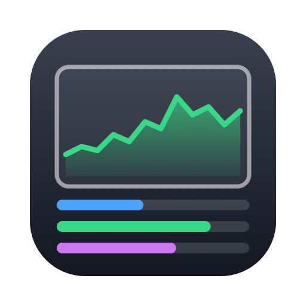

<p align="center"></p>

# Sysbar

A tiny macOS menu bar app that shows the **System Stats** panel from
[oMLX](https://github.com/jundot/omlx) — CPU E/P-core usage, thermal state,
load average, uptime, GPU usage, GPU memory and a memory breakdown — behind an
animated, [Stats](https://github.com/exelban/stats)-style menu bar icon.

- Native Swift/AppKit + SwiftUI, no dependencies, no Xcode project.
- Public APIs only (Mach host statistics, IOKit accelerator stats,
  `vm_statistics64`) — no `sudo`, no helper tools.
- Runs as a menu bar–only app (no Dock icon).

## Requirements

- macOS 14 (Sonoma) or later, Apple Silicon recommended (E/P-core split).
- Swift toolchain: Xcode **or** just the Command Line Tools
  (`xcode-select --install`).

## Build & install

```bash
git clone https://github.com/rodrigotrombeta/Sysbar.git
cd Sysbar
./build.sh install
```

`./build.sh install` builds a release binary, assembles and ad-hoc signs
`build/Sysbar.app`, copies it to `/Applications` (replacing any previous copy)
and launches it.

To only build without installing:

```bash
./build.sh
open build/Sysbar.app
```

## Rebuild & reinstall after changes

After editing the code (or pulling updates), run the same command again — it
quits the running Sysbar, replaces `/Applications/Sysbar.app` and relaunches:

```bash
git pull            # if updating from GitHub
./build.sh install
```

If you change the app icon drawing in `scripts/make-icon.swift`, regenerate the
icon first:

```bash
swift scripts/make-icon.swift
./build.sh install
```

## Uninstall

```bash
pkill -x Sysbar; rm -rf /Applications/Sysbar.app
defaults delete local.sysbar.app   # optional: remove saved settings
```

If "Open at login" was enabled, turn it off from the menu before deleting (or
remove Sysbar under System Settings → General → Login Items).

## Using it

Click the menu bar icon to see the CPU / GPU / Memory panels. Below them:

| Menu | Options |
|---|---|
| **Métricas no ícone** (icon metrics) | One or more of: CPU (total), CPU E-cores, CPU P-cores, GPU, GPU memory, RAM. Each becomes its own mini widget that moves with usage. |
| **Estilo do ícone** (icon style) | Line chart, bar, percentage, or chart + percentage; toggle the small stacked label (CPU/GPU/RAM). |
| **Cores** (colors) | Monochrome (follows the menu bar theme), per-metric color, or by utilization (green → orange → red). |
| **Intervalo de atualização** (refresh interval) | 0.5 s – 5 s. |
| **Abrir ao iniciar sessão** | Launch at login (requires the app in `/Applications`). |

Settings persist in `UserDefaults` (`local.sysbar.app`).

### Previewing the drawing

```bash
build/Sysbar.app/Contents/MacOS/Sysbar --preview /tmp/sysbar-preview
```

writes PNGs of every icon style/color mode (light and dark) and of the stats
panel, then exits.

## Project layout

```
Sources/Sysbar/
  main.swift                 app entry point (+ --preview mode)
  AppDelegate.swift          status item, menu, sampling timer, settings actions
  SystemStatsSampler.swift   CPU/GPU/memory readings   (adapted from oMLX)
  SystemStatsPanels.swift    CPU/GPU/Memory SwiftUI panels (adapted from oMLX)
  StatsTheme.swift           colors/fonts + sparkline view
  StatusIconRenderer.swift   animated Stats-style menu bar icon
  IconSettings.swift         icon metrics/style/color options (UserDefaults)
scripts/make-icon.swift      generates Resources/AppIcon.icns
build.sh                     build / install script
```

## Credits & license

`SystemStatsSampler.swift`, `SystemStatsPanels.swift` and the sparkline view
are adapted from [oMLX](https://github.com/jundot/omlx) by jundot, licensed
under the Apache License 2.0 (see `LICENSE`). The menu bar icon design is
inspired by [Stats](https://github.com/exelban/stats) (no code copied).
