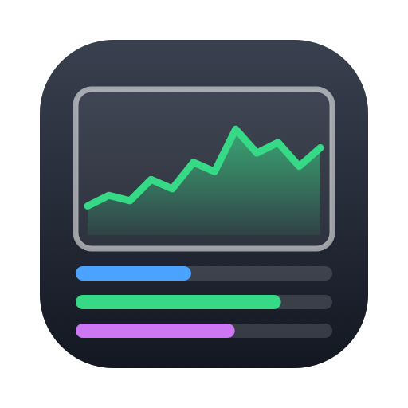
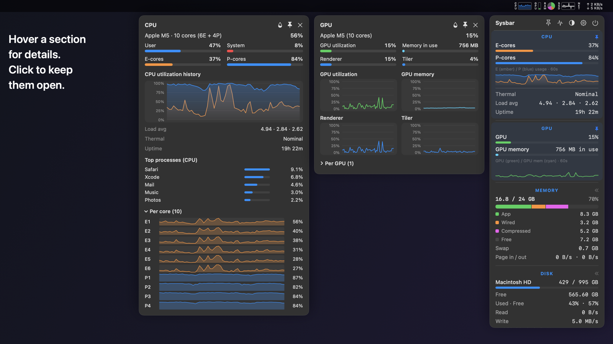
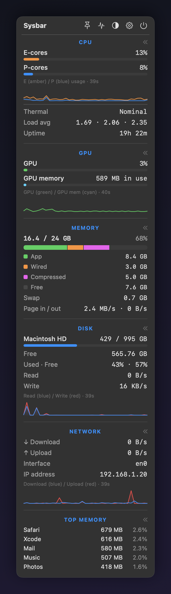
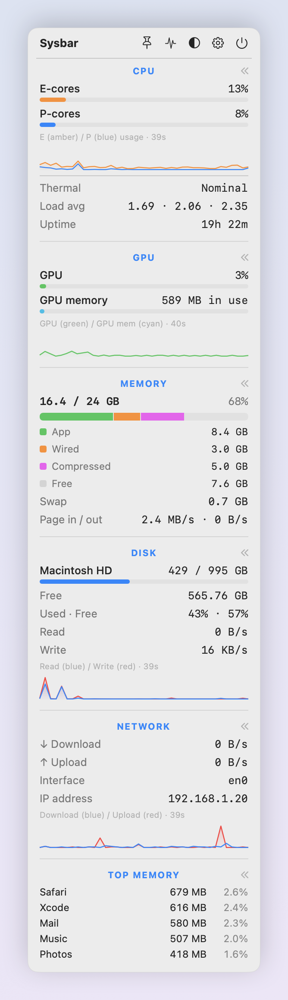
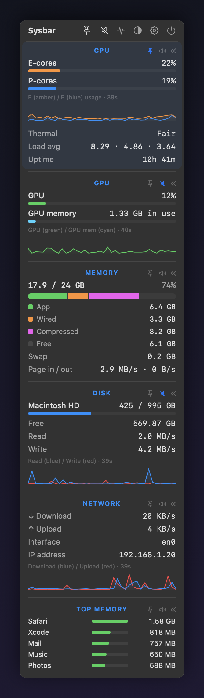
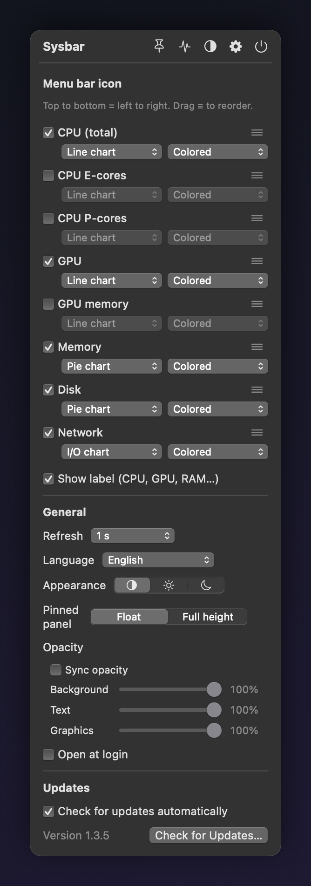
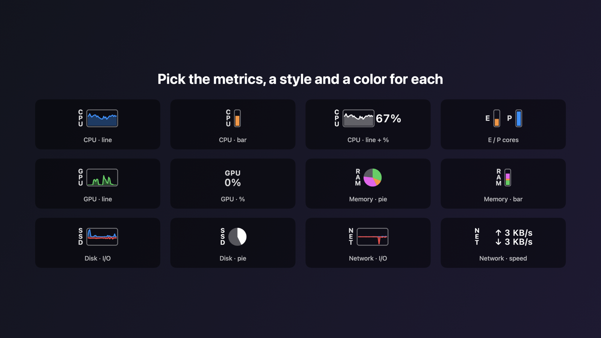

<p align="center"></p>

# Sysbar

A tiny macOS menu bar app that shows the **System Stats** panel from
[oMLX](https://github.com/jundot/omlx) — CPU E/P-core usage, thermal state,
load average, uptime, GPU usage, GPU memory and a memory breakdown — plus
Disk (usage, read/write speed) and Network (download/upload, interface, IP)
panels, behind an animated,
[Stats](https://github.com/exelban/stats)-style menu bar icon.
Available in **English** and **Portuguese**.

<p align="center">
  <a href="docs/sysbar-demo.mp4"></a>
  <br><sub>▶︎ Click for the full-quality <a href="docs/sysbar-demo.mp4">demo video (MP4, with sound)</a>.</sub>
</p>

- Native Swift/AppKit + SwiftUI, no dependencies, no Xcode project.
- Public APIs only (Mach host statistics, IOKit accelerator and block-storage
  stats, `vm_statistics64`) — no `sudo`, no helper tools.
- Runs as a menu bar–only app (no Dock icon). Small: ~0.8 MB on disk,
  ~35 MB of RAM with the panels closed.

## Screenshots



<table>
  <tr>
    <td align="center"></td>
    <td align="center"></td>
    <td align="center"></td>
    <td align="center"></td>
  </tr>
  <tr>
    <td align="center"><sub>Main panel (dark)</sub></td>
    <td align="center"><sub>Main panel (light)</sub></td>
    <td align="center"><sub>Pinned to a screen edge, GPU and Disk muted</sub></td>
    <td align="center"><sub>Settings</sub></td>
  </tr>
</table>



## Download & install

1. Download **`Sysbar-<version>.dmg`** from the
   [latest release](https://github.com/rodrigotrombeta/Sysbar/releases/latest).
2. Open it and drag **Sysbar** onto **Applications**.
3. Open Sysbar from Applications. Its icon appears in the menu bar (there's no
   Dock icon).

**First launch:** Sysbar isn't signed with an Apple Developer ID or notarized,
so macOS blocks it the first time ("Apple could not verify…"). To allow it once:

- Open **System Settings → Privacy & Security**, scroll down and click
  **Open Anyway** next to the Sysbar message, then confirm; **or**
- in Terminal:

  ```bash
  xattr -dr com.apple.quarantine /Applications/Sysbar.app
  ```

To update, download the new DMG and replace the app in Applications (quit
Sysbar first).

## Requirements

- macOS 14 (Sonoma) or later, Apple Silicon recommended (E/P-core split).
- Swift toolchain: Xcode **or** just the Command Line Tools
  (`xcode-select --install`).

## Build from source

```bash
git clone https://github.com/rodrigotrombeta/Sysbar.git
cd Sysbar
./build.sh install
```

`./build.sh install` builds a release binary, assembles and ad-hoc signs
`build/Sysbar.app`, copies it to `/Applications` (replacing any previous copy)
and launches it.

To only build without installing:

```bash
./build.sh
open build/Sysbar.app
```

## Rebuild & reinstall after changes

After editing the code (or pulling updates), run the same command again — it
quits the running Sysbar, replaces `/Applications/Sysbar.app` and relaunches:

```bash
git pull            # if updating from GitHub
./build.sh install
```

To package a release (universal app, DMG and ZIP in `dist/`):

```bash
scripts/release.sh
```

To regenerate the README screenshots, GIF and demo video in `docs/` (needs
`ffmpeg`; process names and the IP address are replaced with neutral ones):

```bash
scripts/readme-media.sh
```

If you change the app icon drawing in `scripts/make-icon.swift`, regenerate the
icon first:

```bash
swift scripts/make-icon.swift
./build.sh install
```

## Uninstall

```bash
pkill -x Sysbar; rm -rf /Applications/Sysbar.app
defaults delete local.sysbar.app   # optional: remove saved settings
```

If "Open at login" was enabled, turn it off from the menu before deleting (or
remove Sysbar under System Settings → General → Login Items).

## Using it

Click the menu bar icon to open the Sysbar panel. It stays open while you
interact with it (click outside it, press Esc or click the icon again to close).
With several displays, the panel opens on the one whose menu bar you clicked.

**Pinning:** 📌 opens *Pin to left edge* / *Pin to right edge*, each with
**Float** (the panel floats at its content height) or **Full** (it fills the
whole side of the screen, with square corners). The panel pins to the display
where you click and returns there after a restart or when that monitor is
reconnected. When it's pinned, clicking the menu bar icon unpins and closes it.

**Header (always on top):** 📌 pin · 💧 opacity and 🔇 Mute all (edge panel
only) · Activity Monitor (menu bar panel only) · appearance (System → Light →
Dark) · ⚙︎ settings · quit.

**Sections:** CPU · GPU · Memory · Disk · Network · Top memory (top 5 processes) · Claude (Claude Code limits) · Clock (calendar and time zones). Choose which ones appear in Settings › Dashboard.

- **Hover** a section to open its detailed metrics beside the panel.
- **Click** a section to keep its details open (📌). Several can stay pinned at
  once; they are placed side by side without overlapping. Click again, or the
  ✕ in the detail panel, to close.
- **Reorder sections** by dragging a section's title row (CPU, GPU,
  Memory…) up or down. The order is shared by both panels and remembered.
- On the edge-pinned panel each section also has a 📌 button to keep its
  details open.
- **Mute mode** (panel pinned to a screen edge): the 🔈 next to a section's `<<`
  stops its details from opening on hover; *Mute all* (🔇 in the header) does
  it for every section. Clicking a muted section still pins its details.
- **Move** a pinned detail panel anywhere by dragging its title row (dragging a
  hover preview pins it).
- **Opacity:** Background, Text and Graphics each have their own slider (or
  one slider with *Sync opacity*), from 0 % — e.g. only the charts floating on
  the desktop. It's global, in Settings or the 💧 of a pinned panel; a detail
  panel can switch to *This panel only* to keep its own, saved opacity.

| Details | Contents |
|---|---|
| **CPU** | Chip and core layout (e.g. 6E + 4P), user / system / E-cores / P-cores, utilization history, load average, thermal state, uptime, top 5 processes by CPU, and a **Per core** dropdown with a chart for every core. |
| **GPU** | GPU name and core count, GPU / renderer / tiler utilization and GPU memory, with a history chart for each, plus a **Per GPU** dropdown with a chart per GPU device. |
| **Memory** | Used / total, memory pressure, App / Wired / Compressed / Swap, a stacked chart of App / Wired / Compressed / Swap as % of RAM (smallest at the bottom), usage history, page-in/out history, top 10 processes by memory with their share of RAM. |
| **Disk** | Startup volume usage as a **Pie** or **Progress** bar, used / free percentages, read/write speed, totals since boot, read/write history. *Detailed* splits the pie into macOS, apps, swap, files & other, purgeable and free (measured on demand, ~10 s); optionally the menu bar disk pie/bar shows the same categories for an hour after each measurement. |
| **Network** | Download / upload speed and peaks, interface, IP address, history. |
| **Claude** *(beta)* | Claude Code's **5-hour** and **weekly** limits: % used, when each resets, and a chart of usage vs. time in each window with a dashed **projection at the current pace** and an even-pace diagonal, so you can see whether you'll hit the limit before the reset ("At this pace: limit at 14:06, 42 min before reset"). Turn on *Fetch limits from Anthropic* in Settings: Sysbar reads Claude Code's login from the Keychain (macOS asks once) and asks `api.anthropic.com` every 5 minutes, like Claude Code's `/usage` (no tokens used). That address is undocumented and may change. Several accounts are shown one under the other: *Add account…* in Settings opens Claude Code's login for another account in Terminal (copy the link into the browser where that account is signed in). The pace is projected only after 15 % of a window has passed. Alternatively it can record the limits Claude Code passes to its status line when used in a terminal. |
| **Clock** | Month calendar (today in red) and one clock per time zone: analog face, flag, date and time, GMT offset, weekday. Add as many time zones as you like; the first two can go to the menu bar. |
| **Top processes** | Top 15 by memory (with % of RAM) and top 10 by CPU. **Admin rights…** asks for your administrator password to also list other users' processes (e.g. WindowServer); asked again after Sysbar restarts. |

> macOS's public APIs report GPU utilization per GPU *device* (one on Apple
> Silicon), not per GPU core, and don't expose Neural Engine (ANE) usage or
> FPS, so those aren't shown. Processes owned by other users (e.g.
> WindowServer) are only listed after *Admin rights…*: Sysbar then runs a
> copy of itself as root that only answers "sample now" requests from Sysbar
> and exits when you click Stop or quit Sysbar.

**Settings (⚙︎)** — changes apply instantly and the panel stays open; click anywhere outside the panel to go back to the stats:

| Setting | Options |
|---|---|
| **Menu bar icon** | For each metric — CPU (total), E-cores, P-cores, GPU, GPU memory, Memory, Disk, Network, Claude Code limits, Clock: show it or not, its **style** and its **color**. Drag the ≡ handle to reorder them: top to bottom in the list = left to right in the menu bar. |
| Styles | CPU/GPU metrics: line chart, bar, pie, percentage, chart + %. Memory: pie, bar, line, percentage, used / free (GB), I/O (page-ins/outs). Disk: pie, bar, percentage, used / free (GB), I/O (read/write). Network: I/O chart (download/upload) or speed text. Claude Code limits: `42% 5h` over `18% 7d` (orange/red when the pace leads to the limit). Clock: date and time of the first two time zones, with an adjustable font size. |
| Colors | **Colored**, **Monochrome** (white/black, follows the menu bar) or **By utilization** (green → orange → red). Memory pies/bars split into App (green) / Wired (orange) / Compressed (magenta). |
| Dashboard | Which sections appear in the Sysbar panel, and the Clock time zones (add, reorder, remove; menu bar font size). |
| Show label | The small stacked label (CPU, GPU, RAM, SSD, NET). |
| General | Refresh interval (0.5–5 s), Language (English / Português), Appearance (System / Light / Dark), Pinned panel (Float / Full height), Text color (System, presets or a color wheel), Opacity (Background / Text / Graphics, or Sync opacity), Open at login (needs the app in `/Applications`). |
| Updates | **Check for Updates…** asks GitHub for the latest release; if it is newer, Sysbar offers to download its DMG (install it like the first time). "Check for updates automatically" (on by default) does this once a day and stays silent when offline. Sysbar only talks to `api.github.com` (updates) and, if you turn on *Fetch limits from Anthropic*, `api.anthropic.com` (Claude Code limits). |

Settings persist in `UserDefaults` (`local.sysbar.app`).

### Previewing the drawing

```bash
build/Sysbar.app/Contents/MacOS/Sysbar --preview /tmp/sysbar-preview
```

writes PNGs of every icon style/color mode (light and dark) and of the stats
panel, then exits.

## Project layout

```
Sources/Sysbar/
  main.swift                 app entry point (+ --preview mode)
  AppDelegate.swift          status item, sampling timer, panel open/close, pin
  SystemStatsSampler.swift   CPU/GPU/memory/disk readings (adapted from oMLX)
  SystemStatsPanels.swift    CPU/GPU/Memory/Disk SwiftUI panels (adapted from oMLX)
  Localization.swift         English / Portuguese strings (tr("en", "pt"))
  StatsTheme.swift           colors/fonts + sparkline view
  StatusIconRenderer.swift   animated Stats-style menu bar icon
  AppModel.swift             shared observable state for all panels
  MainPanelView.swift        main panel: header, sections, settings
  DetailViews.swift          hover/pinned detail panels (CPU, GPU, Memory, …)
  Charts.swift               history charts, meters
  PanelWindows.swift         floating panels, hover tracking, detail placement
  ProcessSampler.swift       top processes by memory / CPU (libproc)
  IconSettings.swift         settings: icon, opacity, pin… (UserDefaults)
  DiskBreakdown.swift        "Detailed" disk usage (APFS volumes, /Applications)
  ProcessHelper.swift        "Admin rights": root helper listing every process
  UpdateChecker.swift        "Check for updates" via GitHub releases
  DemoVideo.swift            `--demo-frames`: promo animation frames (scripts/demo-video.sh)
  Screenshots.swift          `--screenshots`: README panel and settings images
scripts/make-icon.swift      generates Resources/AppIcon.icns
scripts/release.sh           universal build + DMG/ZIP for GitHub releases
scripts/readme-media.sh      README screenshots, GIF and demo video (docs/)
docs/                        README images and demo video
build.sh                     build / install script
```

## Credits & license

`SystemStatsSampler.swift`, `SystemStatsPanels.swift` and the sparkline view
are adapted from [oMLX](https://github.com/jundot/omlx) by jundot, licensed
under the Apache License 2.0 (see `LICENSE`). A copy of the license ships in
every build and package (`Sysbar.app/Contents/Resources/LICENSE`, plus
`LICENSE.txt` in the DMG). The menu bar icon design is
inspired by [Stats](https://github.com/exelban/stats) (no code copied).
